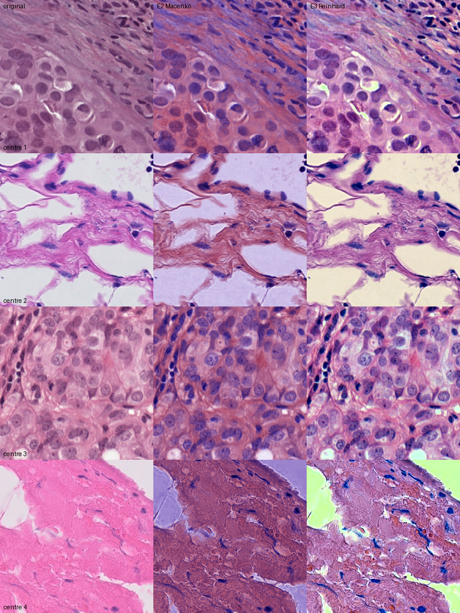
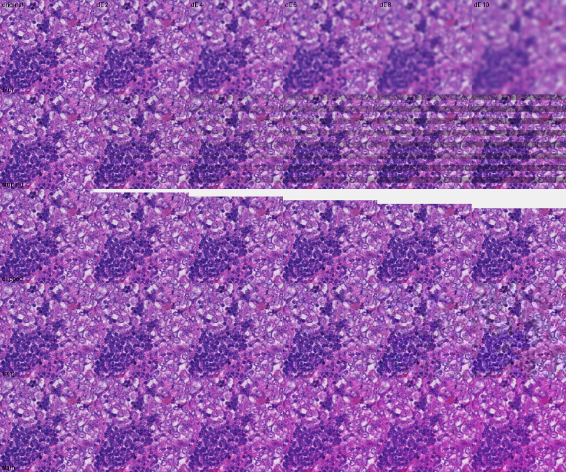
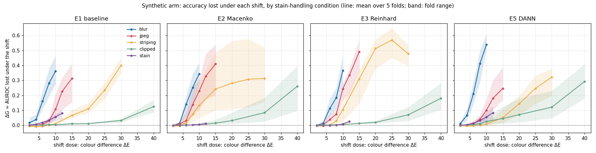
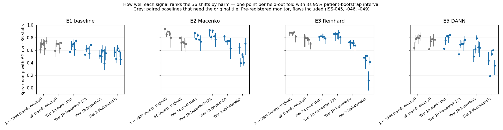
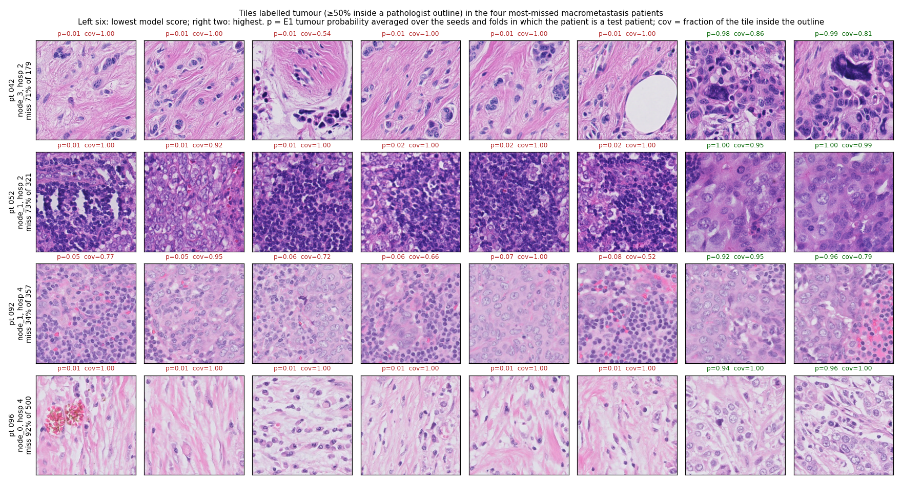

# stainrob-benchmark

Research code for a PhD dissertation (Data Science, Harrisburg University of Science and
Technology) on **label-free validity monitoring for computational pathology**: detecting
when stain or scanner variation at a new site has made a deployed model's outputs
unreliable, without needing new labels at that site.

> **Status: work in progress (4 November 2026).** The pre-registered CAMELYON17 round (v0.1) is complete and
> reported as specified; a slide-level second round (v0.2) is being built on a separate branch.
> - **v0.1, pre-registered** ([plan](docs/analysis_plan.md), committed before any test result; [run log](docs/run_log.md)):
>   60 training runs (4 stain-handling conditions × 5 held-out hospitals × 3 seeds). The monitor's signal rises with
>   tile-level harm (H1 supported); it does not rank harm better than image-difference measures that need the original
>   tile (H2 not supported); a prediction about colour statistics failed (H3).
> - **v0.1, post hoc** ([specified before running](docs/posthoc_analyses.md)): checking the monitor against realistic
>   nulls found three design flaws (which reference, how it is resampled, what the projection is fitted on); corrected,
>   the monitor holds its false-alarm rate but alarms on a third to a half of harmless shifts and at every new
>   hospital — it tracks appearance, not harm. A consistent stain drift that costs nothing sets pixel statistics off
>   90% of the time. The only real-site gap (hospital 2) is mostly one patient, and tile-level AUROC turned out to be a
>   weak outcome: at another hospital accuracy fell 21 points while AUROC barely moved.
> - **v0.2, in progress** on the [`v0.2` branch](https://github.com/athakur569/stainrob-benchmark/tree/v0.2) ([plan](https://github.com/athakur569/stainrob-benchmark/blob/v0.2/docs/v0.2/plan.md)): every slide at slide level (500 labelled, 146 with metastases;
>   500 unlabelled), a slide-level model, and label-free monitors that watch the deployed model rather than its inputs.
>
> Review is welcome at any level; the [open questions](#open-questions-for-review) list where it would help most.

## The question

A tumour-detection model is validated at one set of hospitals. A new hospital's slides
look different (stain, scanner). Is the model still valid there? Accreditation (CAP)
requires revalidation after significant changes but does not specify a method, and the
labels needed to measure performance directly are usually unavailable at deployment.

The approach, developed in three papers:

1. **Detect (Paper 1, in progress).** During development, where labels exist, measure the
   generalisation gap **ΔG = AUC on unseen patients from seen centers − AUC on an unseen
   center**. Relate ΔG to label-free signals: input divergence (MMD, Wasserstein; *Tier 1*)
   and model response (Mahalanobis distance, energy score; *Tier 2*). At deployment only the
   label-free signals are computed, giving a *predicted* ΔG.
2. **Prescribe (Paper 2, planned).** Map the type of shift to a corrective action.
3. **Verify (Paper 3, planned).** Check that correct predictions rest on the right tissue.

The central claim to test: **image change is not the same as harm.** A monitor should flag the
shifts that cost accuracy (for example, out-of-focus scanning) and not the ones that don't (for
example, a modest stain-colour change) — something a simple measure of image difference cannot do.

The method assumes **covariate shift**: image appearance changes, while the relationship
between tissue and diagnosis does not. That fits stain and scanner variation. It does not
cover changes in label definitions or patient population.

## Data

Public, de-identified data only (IRB: Exempt).

- **CAMELYON17 — the rehearsal.** Lymph-node H&E slides, 5 hospitals (three scanner types),
  100 patients, 500 slides, tumour outlines on 50 slides. Small enough to exercise and debug
  every step quickly. Only 4–7 patients per hospital have outlined tumour, so its five
  real hospitals give descriptive results; the inferential weight rests on a controlled
  synthetic-shift experiment, where the same patients are compared under different shifts.
- **TCGA (BRCA, COAD, LUAD) — the full study, later.** Starts afresh; nothing tuned on
  CAMELYON17 is carried over. In these cohorts every normal-tissue slide is a frozen section,
  so the task must first be redesigned (`docs/research_log.md`, ISS-012).

Slides are not in this repository. `scripts/download_camelyon17.py` registers a local
copy and builds the slide table.

## What exists today

Every row is built and covered by the test suite (189 tests); "checked on real tiles" means the
step was also run on the frozen CAMELYON17 tiles and inspected before use.

| Step | Where | Checked on real tiles |
|---|---|---|
| Slide table, tiling at 0.5 µm/px, quality control, patient splits, SHA256 freeze | `data/` | yes — 11,763 tiles frozen; tiles verified against raw slides on all 5 scanners |
| Fold loader: leave-one-hospital-out roles, freeze check at start-up | `data/dataset.py` | yes — 12–15 tumour patients in-domain per fold, 4–7 at the held-out hospital |
| Training run: WILDS schedule, per-tile predictions and 2,048-d features saved | `training/run.py`, `scripts/train.py` | yes — bit-for-bit reproducible on GPU; loss levels off by epoch 8–10; ~4 min per run |
| Conditions E1 (baseline), E2 (Macenko), E3 (Reinhard), E5 (DANN over training hospitals) | `training/run.py` | yes — see figure below; DANN's hospital-recognition falls from 83% to 32% (chance 25%) |
| Synthetic shifts: blur, striping, clipped tissue, JPEG, stain colour; doses matched by colour difference | `data/shifts.py`, `configs/shift_doses_camelyon17.json` | yes — see figure below |
| Monitor Tier 1: 23 pixel statistics; frozen generic-encoder features | `monitor/` | yes — 7,913 training-split tiles |
| Monitor Tier 1/2 statistics and alarms (with slide-level calibration) | package [`wsidrift`](https://pypi.org/project/wsidrift/) | simulation: false alarms at the set rate |
| Uncertainty: patient-clustered bootstrap, joint across conditions; predictor comparison | `evaluation/bootstrap.py` | tests |
| Analysis plan (pre-registration), dose-range pilot on training data | [`docs/analysis_plan.md`](docs/analysis_plan.md), `docs/pilot/` | committed before any test result |
| Training matrix: 60 runs, resumable | `scripts/run_matrix.py` | done — real-arm results in the [run log](docs/run_log.md) |
| Synthetic arm: every run scored under 36 shift doses | `scripts/score_synthetic.py` | done |
| Pre-registered analysis (H1–H3, matched-dose slice, alarms, null check) | `scripts/analyse.py`, `evaluation/analysis.py` | done — [run log](docs/run_log.md) |
| Post-hoc false-alarm checks on new patients (training tiles only) | `scripts/null_check_posthoc.py` | done — see below |
| CycleGAN (E4), SimCLR (E6) | — | not part of the rehearsal |

### Checks on real tiles

Stain normalisers on one training tile per hospital (left: original; middle: Macenko; right: Reinhard).
This check caught a bug that turned every Macenko output black (ISS-041) before any run used it.



Each synthetic shift family at the five doses (colour difference ΔE 2–10), on one training tile:



### First results

Accuracy lost under each synthetic shift (36 doses, five shift types), by stain-handling condition. Stain
normalisation (E2, E3) removes stain harm but adds fragility to compression and striping; DANN (E5) is the most
fragile to blur.



How well each signal ranks the 36 shifts by harm. The monitor (blue) tracks harm, but does not beat the paired
image-difference measures (grey), which need the original tile a deployed monitor never has.



### What checking the false-alarm rate found

A monitor that alarms on every new batch of patients is useless, so the false-alarm rate was measured directly:
the training patients of each fold were split into random halves (no shift at all), 200 times per fold, and every
tier was asked whether the halves differ (target: 5%). Mean over the five folds:

| Tier | Clustered by slide (pre-registered) | By patient | By patient, projection fitted on both batches |
|---|---|---|---|
| 1a pixel statistics | 33% | 2.6% | 2.3% |
| 1b DenseNet-121 (primary) | 49% | 5.8% | 3.2% |
| 1b ResNet-50 (sensitivity) | 97.5% | 54% | 4.2% |
| 2 model response | 0.5% | 0.5% | — |

Two independent faults: resampling slides when reference and deployment differ by *patient* (ISS-046), and fitting
the feature projection on the reference alone, which no permutation test survives in high dimension (ISS-049).
The pre-registered check had split slides of the same patients, which is why it looked calibrated. Details and the
matched comparison of projection choices: [`docs/posthoc_analyses.md`](docs/posthoc_analyses.md) (P1–P1d).

### Where the model fails

The same few tumour patients are missed in every fold they appear in; their missed tiles lie inside the tumour
outline and are scored confidently negative. Whether those tiles are tumour or enclosed non-tumour tissue awaits
pathologist review (ISS-048).



### How results are protected

- The tiles, splits and configuration are frozen and hashed; every run verifies the hashes first.
- Test sets cannot be scored until `docs/analysis_plan.md` is committed to git
  (`training/run.py`, `require_committed_plan`); every run records the plan commit it ran under. The
  plan's commit timestamp shows it came before any test result.
- Every problem met and every design decision is logged with its reasoning in
  [`docs/research_log.md`](docs/research_log.md).
- Changes made after the plan are numbered [deviations](docs/deviations.md) (D1–D6, all fixed before the results
  they affect). Analyses designed after seeing results are [specified and committed before they run](docs/posthoc_analyses.md).

### The frozen CAMELYON17 tile set

`data/camelyon17/` holds the record of the frozen tile set: `freeze.json` (SHA256 of every
part), the slide table, the tile manifest, and every split file. `tests/test_frozen_record.py`
re-hashes them against `freeze.json`.

| | |
|---|---|
| Slides used | 352 of 500 eligible (318 negative slides + 34 outlined tumour slides; ITC and outline-free tumour slides excluded); 351 contribute tiles |
| Tiles | 11,780 extracted, **11,763 pass QC** (5,890 tumour, 5,873 normal) |
| Sampling | ≤ 500 tumour tiles per slide; normals 1:1 with tumour per center, spread equally across slides; seed 42 |
| Splits | 98 patients with usable tiles → 58 train / 21 validation / 19 test, split within each center; every center's test set holds ≥ 100 tumour tiles |
| Freeze | master SHA256 `1a98ed80…d192381` |

Splits are derived from a hashed list of all patients (`patient_universe.txt`) with a seed
derived from it, so they reproduce exactly. No patient appears in more than one split.

## Reproduce

Two conda environments: `stainrob` (`environment.yml`, exact versions; splits, training,
tests) and a separate environment with OpenSlide for the slide-reading scripts.

```bash
conda env create -f environment.yml && conda activate stainrob
pip install -e .
pytest tests                      # full test suite, no slides needed
```

With CAMELYON17 downloaded (edit the paths at the top of `configs/tiling_camelyon17.yaml`):

```bash
OUT=/path/to/camelyon17/derived/tiles_v1      # = out_dir in the config
python scripts/download_camelyon17.py --output /path/to/camelyon17/raw --create-metadata
python scripts/tiling_plan.py    --config configs/tiling_camelyon17.yaml      # candidate tiles
python scripts/tiling_extract.py --config configs/tiling_camelyon17.yaml      # tiles + QC
python scripts/create_splits.py --metadata $OUT/split_input.csv --output $OUT/splits \
    --project-id CAMELYON17 --patient-id-column patient_id --group-column center \
    --patient-label-rule any --weight-column tumour_tiles --min-test-weight 100
python scripts/freeze_dataset.py --config configs/tiling_camelyon17.yaml          # freeze
python scripts/freeze_dataset.py --config configs/tiling_camelyon17.yaml --verify --full
```

A run that reproduces the same tiles produces the same `freeze.json` hashes.

Then, per condition, fold and seed (scoring training tiles only until the plan is committed):

```bash
python scripts/calibrate_shifts.py --tiles $OUT --out configs/shift_doses_camelyon17.json
python scripts/train.py --tiles $OUT --runs /path/to/runs --condition E1 --holdout 0 --seed 42 --train-only
python scripts/extract_tier1.py --tiles $OUT --out /path/to/tier1 --subset train-split
```

After the analysis plan is committed (test sets open):

```bash
python scripts/run_matrix.py        --tiles $OUT --runs /path/to/runs                 # 60 runs, resumable
python scripts/extract_tier1_arms.py --tiles $OUT --out /path/to/tier1                # monitor features, both arms
python scripts/score_synthetic.py   --tiles $OUT --runs /path/to/runs                 # every run × 36 doses
python scripts/analyse.py --tiles $OUT --runs /path/to/runs --tier1 /path/to/tier1 --out /path/to/analysis
python scripts/null_check_posthoc.py --tiles $OUT --runs /path/to/runs --tier1 /path/to/tier1 \
    --out /path/to/null.csv [--fit-on pooled|external] [--thirds]                      # post hoc, training tiles
```

## Repository map

```
configs/                 tiling/QC/split settings; synthetic-shift dose table
data/camelyon17/         record of the frozen CAMELYON17 tile set (hashes, splits, manifest)
docs/analysis_plan.md    the analysis plan (pre-registered)
docs/deviations.md       numbered changes to the plan, each fixed before the results it affects
docs/posthoc_analyses.md analyses designed after seeing results, specified before they run
docs/run_log.md          results in the order they were obtained
docs/pilot/              dose-range pilot results on training data
docs/research_log.md     problems met, their causes and resolutions, and design decisions
docs/figures/            checks on real tiles; where the model fails
scripts/                 command-line steps (tile, split, freeze, train, calibrate shifts, extract features)
src/stain_benchmark/     data, normalization, models, training, monitor features, evaluation
tests/                   pytest suite
```

## Open questions for review

Recorded in the [analysis plan](docs/analysis_plan.md) and the research log:

- **Dose yardstick (ISS-042).** SSIM could not put stain changes and blur on one scale; doses are matched
  by colour difference instead. Any yardstick embeds a judgement about "equal size", so the plan also
  proposes testing directly whether the monitor predicts harm better than image-difference measures.
- **Generic-encoder tier (ISS-043).** The ImageNet ResNet-50 starts from the same weights as the classifier it
  monitors, so DenseNet-121 is the primary Tier 1b encoder and ResNet-50 a sensitivity analysis.
- **The monitor's reference (ISS-045, ISS-046, ISS-049).** Which data the reference is, how it is resampled, and what
  the feature projection is fitted on each decided whether the monitor alarms on any new patients. The corrections
  (held-out reference, patient clusters, external projection) hold the false-alarm rate (post-hoc P1–P3) — but the
  corrected monitor still tracks appearance rather than harm. Is moving to monitors of the deployed model (v0.2) the
  right response?
- **The outcome (run log, 3 Nov).** Tile-level AUROC barely moved where slide-relevant sensitivity fell 21 points.
  Is slide-level sensitivity at the operating point (v0.2) the right definition of harm?
- **Hard patients (ISS-048).** Most of the hospital 2 gap is one patient (P4). Are that patient's missed tiles tumour
  or non-tumour tissue inside a coarse outline? Pathologist review is pending.
- **Small rehearsal dataset (ISS-017).** 4–7 tumour patients per hospital with tile labels; v0.2's slide labels lift
  this to 23–35 tumour slides per hospital.
- **TCGA task (ISS-012).** Tumour-vs-normal is confounded with frozen vs FFPE preparation.

## Known limitations

- **The monitor package on PyPI (wsidrift 0.1.1) calibrates its alarms tile by tile.** On real CAMELYON17
  tiles with no shift, that raised an alarm in 82–100% of cases at a nominal 10% (ISS-039). Calibrating over
  clusters is on wsidrift's main branch (unreleased) and is what this repository uses — but the cluster must be
  the *patient* when reference and deployment are different patients (ISS-046); slide clusters hold only when the
  same patients are on both sides.
- **The pre-registered monitor is reported as specified, flaws included.** Its Tier 1 alarms on new patients even
  without a shift (see the table above), and its Tier 2 reference is the model's own training tiles (ISS-045).
  Corrected versions are reported beside it (post-hoc P1–P3).
- **What was tested is narrower than "harm".** H1 and H2 were evaluated against tile-level AUROC loss; at hospital 4 a
  21-point accuracy drop (all missed tumour, concentrated in two patients) left AUROC almost unchanged. The
  pre-registered results support "the monitor tracks tile-AUROC loss", not "the monitor tracks harm".
- **Appearance is not harm, for the corrected monitor too.** It alarms at every held-out hospital and on 15–51% of
  harmless synthetic shifts (P3).
- **Rehearsal scale.** CAMELYON17 has 4–7 tumour patients per hospital; see the open questions above.

## Related

- [`wsidrift`](https://pypi.org/project/wsidrift/) — the label-free Tier 1 / Tier 2 monitor,
  as a separate package (PyPI 0.1.1; slide-level calibration is on its main branch, unreleased).

## License

MIT. Author: Abhishek Thakur.
