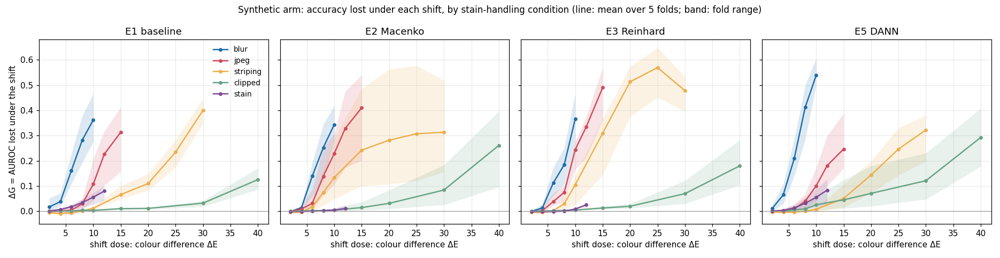
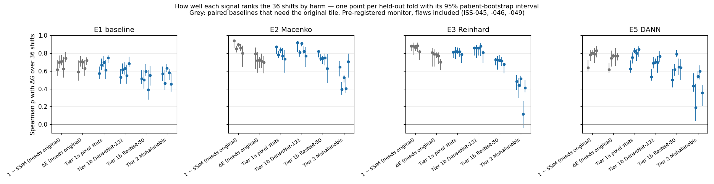

# Run log — CAMELYON17 rehearsal

Results in the order they were obtained, after the analysis plan was committed (`927e44b`,
2 Nov 2026 11:50 EST). Intervals are patient-clustered 95% bootstrap intervals (2,000 resamples).

## 2 Nov 2026 · Fold 0 (held-out hospital 0), E1 baseline, seeds 42 / 99 / 123

| Seed | test_in AUROC (14 tumour patients) | test_cross AUROC (5 tumour patients) | ΔG |
|---|---|---|---|
| 42 | 0.982 [0.957, 0.997] | 0.993 [0.987, 0.996] | −0.011 [−0.036, +0.007] |
| 99 | 0.956 [0.928, 0.996] | 0.994 [0.990, 0.996] | −0.038 [−0.066, +0.003] |
| 123 | 0.984 [0.964, 0.998] | 0.992 [0.983, 0.996] | −0.009 [−0.028, +0.009] |

- **Ceiling contingency (plan §11): did not fire — borderline.** In-domain AUROC averaged over seeds
  0.974 against the threshold 0.98; two of the three seeds individually exceed 0.98 (0.982, 0.984);
  the rule uses the seed average, so it was applied as written.
- **No measurable generalisation gap to hospital 0:** every ΔG interval includes 0.
- **Why the held-out interval is narrower than the in-domain one despite fewer tumour patients
  (checked):** heterogeneity, not an artefact. In `test_in`, two large tumour patients are poorly
  ranked (patient 042, 179 tiles, 65% scored below 0.5; patient 092, 357 tiles, 53%), so resamples that
  repeat them move AUROC a lot; leaving one tumour patient out gives 0.978–0.993. In `test_cross` all
  five tumour patients are ranked well; leaving one out gives 0.990–0.994. Caveat: with 4–7 tumour
  patients, a percentile bootstrap tends to understate uncertainty; held-out-hospital intervals should
  be read as lower bounds on the true uncertainty.
- **Provenance:** each run's `summary.json` records `git_head 4f0280d` (stamped at the end of the run);
  seed 42 started under `927e44b`. Between the two commits: `docs/deviations.md` (new),
  `scripts/run_matrix.py` and `scripts/score_synthetic.py` (new), `scripts/extract_tier1.py` (a `val-test`
  subset added), and in `training/run.py` only `score_tiles` gained an optional feature output. The
  training code path (`train_run`, data loading, model, optimiser) did not change. Every run records the
  plan commit `927e44b`.
- **To check across folds — possible hidden stratification:** two in-domain tumour patients are largely
  missed by the fold-0 models (patient 092: 357 tiles, 53% scored below 0.5; patient 042: 179 tiles, 65%).
  If the same patients, or patients like them, are missed in other folds, a subgroup the model handles badly
  is hiding inside a high aggregate AUROC. Per-patient tumour-tile scores will be tabulated for every fold.
- **For the paper:** every cross-hospital interval rests on 4–7 tumour patients, where a percentile bootstrap
  tends to be too narrow; all such intervals are reported as lower bounds on the uncertainty.

## 2 Nov 2026 · Real arm, all five folds × E1, E2, E3, E5 (60 runs)

Seed-averaged ΔG(AUROC) = AUROC(`test_in`) − AUROC(`test_cross`), 95% patient-clustered bootstrap interval,
labelled by the D5 rule (fixed before folds 1–4 were scored).

| Held-out hospital | Tumour patients (in / cross) | E1 | E2 Macenko | E3 Reinhard | E5 DANN |
|---|---|---|---|---|---|
| 0 | 14 / 5 | −0.019 [−0.037, +0.006] clean | −0.022 [−0.070, +0.001] clean | −0.036 [−0.103, +0.000] clean | −0.017 [−0.043, −0.002] clean |
| 1 | 12 / 7 | −0.001 [−0.030, +0.015] clean | +0.038 [−0.002, +0.124] inconclusive | −0.010 [−0.052, +0.014] clean | −0.001 [−0.024, +0.012] clean |
| 2 | 14 / 7 | **+0.043 [+0.006, +0.136] harm** | **+0.048 [+0.007, +0.159] harm** | **+0.041 [+0.002, +0.148] harm** | **+0.024 [+0.010, +0.046] harm** |
| 3 | 13 / 6 | −0.029 [−0.059, +0.007] clean | −0.018 [−0.067, +0.007] clean | −0.020 [−0.076, +0.008] clean | −0.012 [−0.041, +0.005] clean |
| 4 | 15 / 4 | +0.008 [−0.043, +0.054] inconclusive | −0.011 [−0.084, +0.044] inconclusive | +0.015 [−0.089, +0.104] inconclusive | −0.004 [−0.056, +0.036] inconclusive |

- **Hospital 2 is the one measurable gap, and every condition shows it.** It is the same hospital that WILDS
  (Koh et al. 2021) uses as its held-out test site; that is an observation, not independent validation — WILDS used
  the full CAMELYON17 patch set, and the reason it chose that hospital has not been checked here. **Revised 3 Nov
  (post-hoc P4):** for E1–E3, 67–80% of this gap is one patient (042), and with patients 042 and 052 removed it is
  no longer detectable; only E5's gap survives both removals. So the hospital 2 finding depends on the pathologist
  review of those patients (ISS-048). Struck: an earlier line here said DANN had the smallest gap. Removing patient
  042 reverses the order (E1 0.014 [0.002, 0.035], E5 0.024 [0.007, 0.051]); the intervals overlap with or without
  the patient, so no ordering of the conditions is supported either way.
- **In-domain AUROC is high everywhere** (0.96–0.997). The ceiling contingency (§11) is checked on fold 0 only, by
  design, and did not fire there (0.974); in folds 1 and 2 E1 averages 0.985 and 0.996, so the real arm has little
  headroom in those folds. This supports the plan's choice to make the synthetic arm the controlled evidence.
  Scope of the rule, stated plainly: it was written against fold 0 only (the first fold scored), before any fold
  was scored. Had it been written across folds, folds 1 and 2 would have triggered it.
- **Negative ΔG (the held-out hospital scores higher than in-domain) is common.** It reflects which patients each
  test set happens to contain, not a benefit of being out of domain (next point).
- **Per-patient check (open question from fold 0), E1:** the same patients are missed whichever fold they fall in.
  Patient 042 (hospital 2, 179 tumour tiles) has 62–87% of its tumour tiles scored below 0.5 in every fold,
  in-domain or cross-hospital. Hospital 4's patient 096 (500 tumour tiles, 89% missed) is why fold 4 is
  inconclusive rather than clean. Hospital 2's patient 052 (321 tiles, 70% missed) contributes to fold 2's gap.
  So part of each "hospital" effect is a few hard patients. Figure: `docs/figures/missed_patients_e1.png`.
- **What the missed tiles look like (descriptive; pathologist review pending):** patients 042 and 096 —
  fibrous stroma with scattered single atypical cells, inside the outline of the metastasis; patient 052 —
  dense lymphoid tissue inside the outline, suggesting a coarse outline (label noise) rather than a model error;
  patient 092 — pale tumour cells among lymphocytes, missed with low confidence.
- **Annotation coverage:** tumour tiles at the edge of an outline (50–75% inside) are missed more often (37.5%)
  than tiles fully inside (20.7%), a modest partial-label effect. The four most-missed patients' tiles are almost
  entirely inside the outline (median 0.99–1.0), so edge effects do not explain them. Several tumour patients
  contribute only 1–7 tiles, all from micrometastasis or ITC slides.

## 2 Nov 2026 · Full pre-registered analysis (all folds × E1, E2, E3, E5)

Run under plan `927e44b` with deviations D1–D7; 2,000 patient-bootstrap resamples, 200 permutations; output
`analysis_v1`. The first attempt stopped on an undefined calibration slope (ISS-050, D7) and was rerun from scratch.
The monitor here is the **pre-registered** one, with the flaws found since (ISS-044, -045, -046, -049) still in it.

### Synthetic arm: how much accuracy each shift costs

- Within every family, harm rises with dose. Blur is the most harmful per unit of colour difference; stain the least.
- **Stain normalisation removes stain harm and adds fragility elsewhere.** At ΔE 12, stain costs E1 0.080 AUROC but
  E2 0.011 and E3 0.025. At high doses, E2 and E3 lose more than E1 to JPEG (ΔE 15: 0.41 and 0.49 vs 0.31) and E3
  far more to striping (ΔE 25: 0.57 vs 0.24).
- **DANN (E5) is the most fragile to blur:** 0.54 at ΔE 10 vs 0.36 for E1. These are descriptions; the plan does not
  test differences between conditions.

### H1 — the monitor's signal rises with harm: supported

Spearman ρ between signal and ΔG over the 36 shifts, per fold and condition, one-sided 95% lower bound > 0:
Tier 1b (DenseNet-121) in **20 of 20** cells (ρ 0.53–0.92); Tier 2 in **19 of 20** (ρ 0.12–0.71; the exception is
fold 3, E3: ρ 0.12, lower bound −0.03).

### H2 — the monitor ranks harm better than image-difference measures: not supported

Differences in ρ (monitor − baseline), 95% joint-bootstrap intervals, all 36 shifts:
- **Tier 2** ranks harm worse than ΔE in most cells (interval below 0 in 17 of 20, never above) and worse than 1 − SSIM in all 20.
- **Tier 1b** vs ΔE depends on the condition: better for the normalised conditions (E2, E3: interval above 0 in 6 of
  10 cells, never below) and worse for E1 and E5 (below 0 in 6 of 10, never above). Vs 1 − SSIM it is at or slightly below in every
  cell (differences −0.10 to +0.01; below 0 in 14 of 20).
- By the plan's rule (§10) this counts against H2 for Tier 2, and for Tier 1b against 1 − SSIM. Context the plan
  stated in advance: ΔE and SSIM are *paired* measures that need the original, unshifted tile, which a deployed monitor
  never has. Tier 1b comes within 0.10 of them without it; it does not beat them.
- Matched-dose slice (D1), family pairs ordered as harm orders them, of 10, averaged over folds and doses: 1 − SSIM
  5.8–8.0, Tier 1a 6.1–7.5, Tier 1b 5.5–7.7, Tier 2 5.2–5.8, ΔE 4.8–5.4 (by construction ΔE is nearly tied at a matched dose).

### H3 — Tier 1a over-weights stain: fails

The prediction had three parts. (1) Tier 1a rises with stain dose: ρ 0.43 (fold 0), 0.89 (folds 1–2), 1.00 (folds
3–4) — monotone in two folds only. (2) Stain harm is small relative to blur: holds (E1: stain ΔG 10–27% of blur's
at ΔE 4–10). (3) Tier 1a ranks harm worse than Tier 1b and Tier 2: **fails** — for E1 and E5 Tier 1a's ρ is higher
than Tier 1b's in every fold, and it is higher than Tier 2's in all 20 cells. The likely reason is ISS-044: the stain
family as built moves each tile in a random direction, so a batch barely changes and Tier 1a has little stain signal
to over-weight. Reported as a failed prediction; the consistent-direction stain family (P2) is the test of the idea.

### Alarms

- **Realised false-alarm rate (§9.7, the pre-registered slide-split null):** Tier 1a 0.010–0.035, Tier 2 0.000–0.010
  (both within α = 0.05); **Tier 1b 0.05 (fold 0), 0.08–0.115 (folds 1–4).** With 200 splits the simulation error is
  about 0.015, so by the plan's own rule Tier 1b is **miscalibrated in folds 1–4 and its alarms there are not
  interpreted**. (On splits by patient it is far worse: post-hoc P1.)
- **Unshifted in-domain batch (no shift):** Tier 1a and Tier 1b (DenseNet-121) silent in 5 of 5 folds; Tier 1b
  ResNet-50 alarmed in fold 0. Tier 2 alarmed in 6, 8, 5 and 0 of 15 seed-fold cells for E1, E2, E3, E5 — the
  training-tile reference at work (ISS-045).
- **Synthetic shifts:** Tier 1a and 1b flag every blur, clipped, JPEG and striping dose from ΔE 4 up (and most at ΔE 2),
  including doses that cost almost nothing (clipped up to ΔE 10: mean ΔG ≤ 0.013 for E1–E3, 0.059 for E5); stain only at ΔE ≥ 10. Tier 2 flags in
  proportion to harm more than to dose (blur 10% → 95% of cells from ΔE 2 to 10), on top of its false alarms above.
- **Real arm** (descriptive; five hospitals): Tier 1a and 1b alarmed on every held-out hospital in every condition.
  The AND rule (Tier 1b AND Tier 2, seed majority), scored by D5: hospital 2 (harm) — detection in 4 of 4 conditions;
  hospitals 0 and 3 (clean) — silent in 8 of 8; hospital 1 (clean) — false alarm in 3 of 3 scored (E2 ambiguous);
  hospital 4 — ambiguous in all four. Tier 1b is always on, so the rule is Tier 2 alone in practice.

### Secondary and notes

- **Calibration-slope ΔG** is far noisier than AUROC, as the pilot predicted: real-arm interval widths range from 0.5 to 2.8. Some synthetic cells have no defined slope in any resample (D7): the in-domain scores separate perfectly.
- 1 of 240 ρ estimates lies just above its own percentile interval (resampling ΔG adds noise, which pulls resampled ρ
  down); intervals for ρ are read as approximate.
- **What this means for the next step:** the monitor's continuous signal tracks harm (H1), but as pre-registered it
  neither beats paired image measures (H2) nor gives alarms that can be trusted (§9.7, P1). The post-hoc corrections
  (P3: held-out reference, patient clusters, pooled or external projection) are the analysis that decides whether a
  corrected monitor's alarms carry information. They wait for Abhi's decision.

## 2 Nov 2026 (late) · Post-hoc P5b — does the stain normaliser itself amplify artefacts?

Training-split calibration tiles only; no model, no labels (`docs/posthoc_analyses.md`, P5b). The normaliser does not
read corrupted statistics in a way that matters (estimation ratio ≈ 1 for JPEG and striping), and it amplifies the
artefacts only modestly as a generic encoder sees them (JPEG up to 1.4×, striping ≤ 1.1×). The mechanism proposed for
the normalisers' extra fragility is therefore not supported; the fragility most likely lies in how models trained on
normalised tiles respond to the artefact, which P5's model arms would test.
